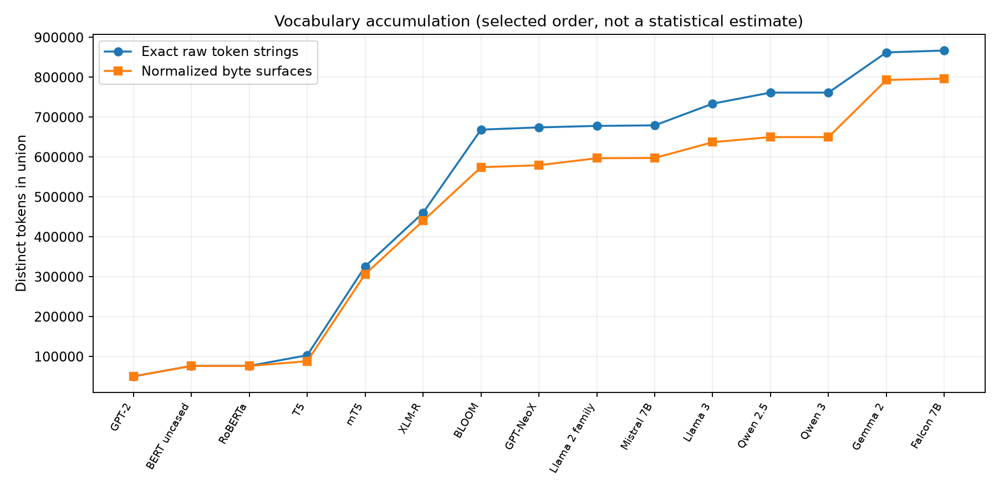
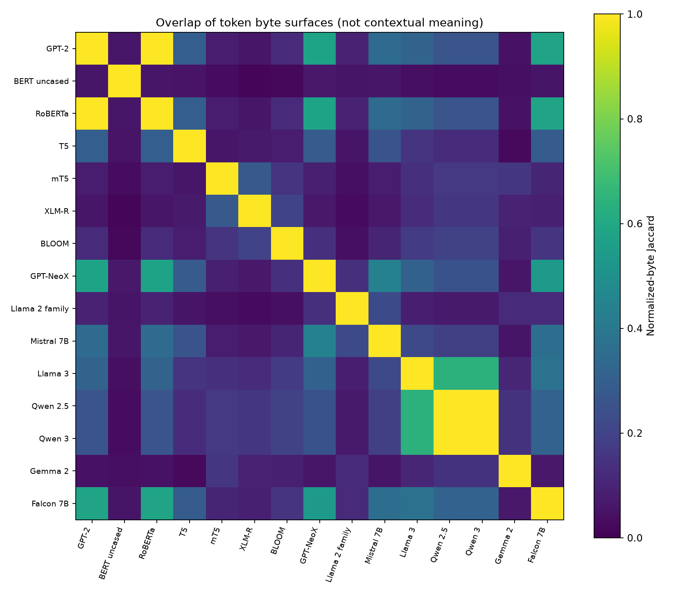
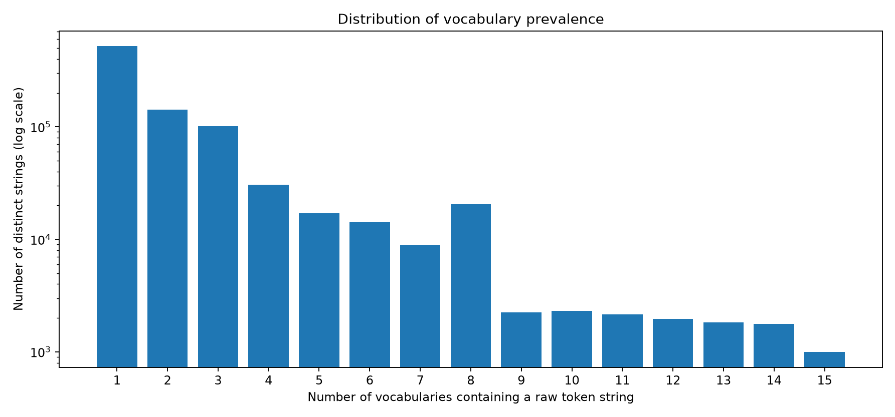

# Vocabulary Atlas: 15 Hugging Face tokenizers

Generated: 2026-11-23T05:27:10.968988+00:00

## Main results

- **15** model tokenizer inventories
- **867,110** distinct raw lexical token strings
- **796,695** distinct normalized byte surfaces
- **1,780,381** raw token occurrences across vocabularies
- **519,745** raw strings appear in exactly one vocabulary
- **998** raw strings occur in all 15 vocabularies
- **15** distinct exact token-string sets
- **15** distinct string-to-ID mappings

## Vocabulary inventory

| Model | Lexical tokens | New raw strings | Cumulative raw union | Unique to this vocabulary |
|---|---:|---:|---:|---:|
| GPT-2 | 50,256 | 50,256 | 50,256 | 0 |
| BERT uncased | 30,517 | 26,197 | 76,453 | 17,219 |
| RoBERTa | 50,260 | 4 | 76,457 | 4 |
| T5 | 31,997 | 26,740 | 103,197 | 2,101 |
| mT5 | 250,097 | 222,697 | 325,894 | 100,957 |
| XLM-R | 249,997 | 134,290 | 460,184 | 110,660 |
| BLOOM | 250,676 | 208,663 | 668,847 | 167,482 |
| GPT-NeoX | 50,275 | 5,548 | 674,395 | 2,769 |
| Llama 2 family | 31,997 | 3,760 | 678,155 | 565 |
| Mistral 7B | 31,997 | 1,356 | 679,511 | 220 |
| Llama 3 | 128,000 | 54,372 | 733,883 | 12,826 |
| Qwen 2.5 | 151,651 | 27,783 | 761,666 | 0 |
| Qwen 3 | 151,655 | 4 | 761,670 | 4 |
| Gemma 2 | 255,994 | 100,759 | 862,429 | 100,257 |
| Falcon 7B | 65,012 | 4,681 | 867,110 | 4,681 |

## Closest pairs (normalized byte-surface Jaccard)

| A | B | Shared byte surfaces | Jaccard |
|---|---|---:|---:|
| Qwen 2.5 | Qwen 3 | 151,651 | 100.00% |
| GPT-2 | RoBERTa | 50,256 | 99.99% |
| Llama 3 | Qwen 2.5 | 109,566 | 64.42% |
| Llama 3 | Qwen 3 | 109,566 | 64.42% |
| GPT-2 | Falcon 7B | 42,465 | 58.33% |
| RoBERTa | Falcon 7B | 42,465 | 58.33% |
| GPT-2 | GPT-NeoX | 36,937 | 58.10% |
| RoBERTa | GPT-NeoX | 36,937 | 58.10% |

## Plots

## Interpretation

The raw-string union is a literal count, not a count of unique words. The normalized-byte union is a comparison aid, not a proof of equivalent tokenization. For example, WordPiece `##word` and `word` have different contextual roles, and byte-level tokens can contain incomplete UTF-8 sequences.

Files: `manifest.json`, `vocabulary_stats.csv`, `pairwise_overlap.csv`, `top_shared_tokens.csv`, `all_token_prevalence.csv.gz`, `summary.json`.
